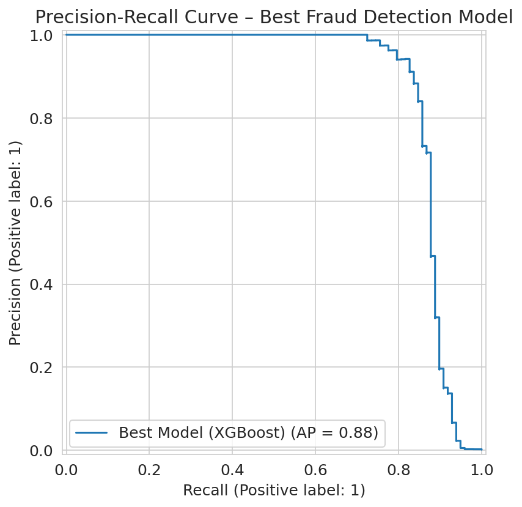

# Credit Card Fraud Detection

[](https://github.com/Retro099/credit-card-fraud-detection/actions/workflows/ci.yml) [](LICENSE) [](.github/workflows/ci.yml)

**TL;DR**
- **Problem:** flag fraudulent card transactions when only 0.172% are fraud (public Kaggle **ULB** "Credit Card Fraud Detection" dataset, 284,807 transactions, 2013 Europe).
- **Approach:** stratified 80/20 train/test split; XGBoost with `scale_pos_weight` compared against logistic regression, random forest and LightGBM on recall / precision / PR-AUC; SHAP explanations; Streamlit + Docker demo.
- **Result:** recall 0.84, precision 0.88, PR-AUC 0.88 on 98 test frauds (single split, single seed). A threshold chosen on a separate **validation** split (0.805) trades 0.35 fewer false alerts for 0.18 more missed frauds per 10k; the shipped threshold stays 0.5.

| Metric (test split, 56,962 tx, 98 fraud) | XGBoost (shipped, 0.5) | Caveat |
|---|---|---|
| Recall / precision (fraud) | **0.84 / 0.88** | one split, no CIs; 1 fraud ≈ 1 recall point |
| PR-AUC | **0.88** (LR baseline 0.72) | baseline re-trained on the fit split |
| False alerts per 10k transactions | **1.93** (14.40 frauds caught) | see threshold table below |

**Live demo:** https://ml-projects-credit-card-fraud-detection.streamlit.app/ (demo may be offline; hosted from the archived ML-Projects repo. On 2026-10-25 it redirected to a Streamlit sign-in page. To run it yourself: `streamlit run app.py`)

## Results

Test split: 56,962 transactions, 98 fraud. Threshold 0.5. Source: committed outputs of `notebooks/Credit_Card_Fraud.ipynb` (single run, not re-trained for this repo).

| Model | Recall (fraud) | Precision (fraud) | PR-AUC | Notes |
|---|---|---|---|---|
| Logistic regression (balanced) | 0.92 | 0.06 | n/a | catches fraud but flags far too many normal ones |
| Random forest (balanced_subsample) | 0.81 | 0.79 | 0.82 | |
| **XGBoost + scale_pos_weight (shipped)** | **0.84** | **0.88** | **0.88** | exact: 0.8367 / 0.8817 / 0.8787 |
| LightGBM (balanced) | 0.84 | 0.84 | 0.87 | close second |



Top SHAP drivers: **V14** and **V17** (strongly negative values push the score toward fraud).

## Threshold and cost (frauds caught vs false alerts)

Source: `results/threshold_analysis.json`, produced by `python scripts/threshold_analysis.py` (CPU, ~6 s; single run, 2026-10-13). Same test split as the notebook (56,962 transactions, 98 fraud). Numbers are **per 10,000 test transactions**; in this split about 17.2 per 10k are fraud.

**How the threshold was chosen:** the training split was cut again into fit (75%) and **validation** (25%, 99 fraud). A fresh XGBoost with the shipped settings was trained on the fit part, and the threshold that gives the best F1 **on validation** was picked: **0.805**. The test set was only used to report the result.

Shipped model (`artifacts/fraud_model_v1.joblib`) on the test split. At 0.5 it reproduces the headline exactly: recall 0.8367, precision 0.8817, PR-AUC 0.8787.

| Threshold | Frauds caught / 10k | Frauds missed / 10k | False alerts / 10k | Recall | Precision |
|---|---|---|---|---|---|
| 0.1 | 14.75 | 2.46 | 4.92 | 0.86 | 0.75 |
| 0.3 | 14.57 | 2.63 | 2.28 | 0.85 | 0.86 |
| **0.5 (shipped)** | **14.40** | **2.81** | **1.93** | **0.84** | **0.88** |
| 0.7 | 14.40 | 2.81 | 1.58 | 0.84 | 0.90 |
| 0.9 | 14.22 | 2.98 | 0.88 | 0.83 | 0.94 |

Validation-chosen threshold (XGBoost re-trained on the fit split, test PR-AUC 0.8828): at **0.805** it catches **14.22** frauds and raises **1.05** false alerts per 10k (recall 0.83, precision 0.93). The same re-trained model at 0.5 gives 14.40 caught and 1.40 false alerts per 10k, so the chosen threshold trades 0.35 fewer false alerts per 10k for 0.18 more missed frauds per 10k (1 fraud out of 98 in absolute terms). Which side is better depends on what a missed fraud costs compared with a review; that cost is not known here, so the shipped 0.5 is kept.

**Logistic-regression baseline** (balanced class weights, same fit split, test PR-AUC 0.7209): at 0.5 it catches 15.80 frauds per 10k but raises **241.92** false alerts per 10k (precision 0.06). Its best-F1 validation threshold rounds to 1.0 because its scores saturate; there it catches 14.04 with 3.51 false alerts per 10k (recall 0.82, precision 0.80). XGBoost is better at every operating point checked.

Caveats: one split and one seed, no confidence intervals; 98 test frauds means one fraud = 0.18 per 10k (about 1 recall point). Data: `creditcard.csv`, sha256 in the JSON.

## How it works
1. Features: `Time`, `Amount` and the anonymised PCA components `V1`–`V28`.
2. Stratified train/test split; imbalance handled with class weights (`scale_pos_weight`) rather than oversampling.
3. Compared logistic regression, resampling variants, random forest, XGBoost and LightGBM on recall, precision and PR-AUC (not accuracy: a model that says "never fraud" is 99.83% accurate).
4. SHAP explains which features push each prediction toward fraud.
5. The chosen pipeline is saved as `artifacts/fraud_model_v1.joblib` (0.5 MB) and served by `predict.py` and `app.py`.

## Quickstart

```bash
pip install -r requirements-dev.txt
pytest -q                      # 8 tests, no dataset needed
streamlit run app.py           # local demo (or: docker compose up --build → http://localhost:8501)
```

More: `python predict.py` (CLI prediction on a dummy row); `python scripts/threshold_analysis.py` (needs `data/creditcard.csv`, writes `results/threshold_analysis.json`).

### Dataset (not committed)
Kaggle "Credit Card Fraud Detection" (ULB, 284,807 transactions): https://www.kaggle.com/datasets/mlg-ulb/creditcardfraud  
Download `creditcard.csv` into `data/` (git-ignored) and run the notebook (Colab works) to retrain.

## Limitations
- Single train/test split; no cross-validation or confidence intervals.
- The shipped threshold stays at 0.5. A threshold chosen on a validation split (0.805) is reported above; the trade-off is small on this data.
- V1–V28 are anonymised PCA features, so SHAP shows *which* component matters, not a business meaning.
- Public 2013 European dataset; real systems need drift monitoring and retraining.
- Model pickle needs `scikit-learn==1.6.1` (pinned).

## Repository structure

```text
notebooks/   # Credit_Card_Fraud.ipynb: EDA, model comparison, SHAP (source of the headline numbers)
scripts/     # threshold_analysis.py: validation-chosen threshold and cost table
results/     # threshold_analysis.json
artifacts/   # fraud_model_v1.joblib (shipped pipeline)
assets/      # plots (PR curve, confusion matrix, SHAP)
app.py, predict.py   # Streamlit demo and CLI
tests/       # 8 pytest tests
```

## Project history
Split out of the archived ML-Projects monorepo on 2026-10-12; this repo, [Retro099/credit-card-fraud-detection](https://github.com/Retro099/credit-card-fraud-detection), is the maintained version. Sibling projects: [japanese-rag-eval](https://github.com/Retro099/japanese-rag-eval), [jp-meeting-to-crm-fields](https://github.com/Retro099/jp-meeting-to-crm-fields).

## License

MIT ([LICENSE](LICENSE)).
